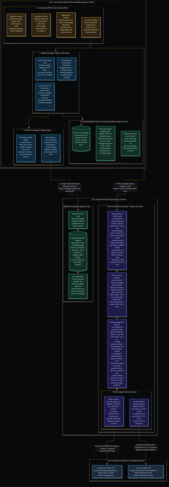

# PromptVault

> **Your personal, private library for AI prompts - organised, rated, and always at hand.**

<!-- Badges Section -->
<p align="left">
  <a href="https://promptvault.multihat.dev/"></a>
  &nbsp;
  <a href="https://github.com/SagarBiswas-MultiHAT/promptVault/actions/workflows/ci.yml"></a>
  &nbsp;
  <a href="https://github.com/SagarBiswas-MultiHAT/promptVault/releases"></a>
  &nbsp;
  <a href="docs/README.md"></a>
  &nbsp;
  <a href="CHANGELOG.md"></a>
  &nbsp;
  <a href=".github/CONTRIBUTING.md"></a>
  &nbsp;
  <a href="LICENSE"></a>
  &nbsp;
  <a href="NOTICE"></a>
</p>
<p align="left">
  
  &nbsp;
  
  &nbsp;
  
  &nbsp;
  
  &nbsp;
  
  &nbsp;
  
  &nbsp;
  
  &nbsp;
  
</p>
<p align="left">
  <strong><a href="https://promptvault.multihat.dev/">🚀 Launch Live Web App</a></strong> &nbsp;•&nbsp;
  <strong><a href="docs/README.md">📖 Architecture & Docs Portal</a></strong> &nbsp;•&nbsp;
  <strong><a href="diagrams/">🗺️ 300% DPI Architecture Diagrams</a></strong> &nbsp;•&nbsp;
  <strong><a href="#-encrypt-your-vault">🔒 Zero-Knowledge Security</a></strong>
</p>

---

## 📋 Table of Contents

- [Comprehensive Architectural & Feature Synthesis](#comprehensive-architectural--feature-synthesis)
  - [Architectural Breakdown](#architectural-breakdown)
  - [Visual Architecture & System Models (300% DPI)](#visual-architecture--system-models-300-dpi)
  - [Docs-as-Code Technical Documentation Portal](#docs-as-code-technical-documentation-portal)
- [What is PromptVault?](#what-is-promptvault)
- [What Can It Do? (Features)](#what-can-it-do)
- [How Does It Compare?](#how-does-it-compare)
- [Requirements](#what-do-you-need-to-run-it)
- [Getting Started (Step by Step)](#getting-started-step-by-step)
  - [Step 1 - Download & Install](#step-1---download-the-project-and-install-dependencies)
  - [Step 2 - Configure API Keys](#step-2---add-your-api-keys)
  - [Step 3 - Start the App](#step-3---start-the-app)
  - [Optional: Cloud Sync (Supabase)](#optional-enable-cloud-sync)
- [Deployment (Production)](#putting-it-on-the-internet-deployment)
  - [Updating on a Droplet / VPS](#updating-your-project-on-a-droplet-vps)
- [Security & Privacy](#is-my-data-safe)
- [Available Commands](#available-commands)
- [Contributing & Community](#contributing--community)
- [License & Attribution](#license--attribution)

---

<a id="comprehensive-architectural--feature-synthesis"></a>
## 🏛️ Comprehensive Architectural & Feature Synthesis 

PromptVault is a privacy-first, client-encrypted AI prompt workbench and local library built with an offline-first architecture, an integrated AI Librarian (powered by Google Gemini with multi-key pooling and Groq fallback), dynamic {{variable}} template injection, multi-device cloud synchronization via Supabase, and real-time usage analytics.

### Architectural Breakdown

<div align="center">

<pre align="center">
┌─────────────────────────────────────────────────────────────────────────────────────────┐
│                                 PROMPTVAULT ECOSYSTEM                                   │
├──────────────────────────────────────┬──────────────────────────────────────────────────┤
│ 🎨 Frontend (Client-Side)            │ 🔒 Cryptography & Storage Layer                 │
│ • React 19 + TypeScript 5.8 (Strict) │ • AES-256-GCM on-device encryption               │
│ • Tailwind CSS v4 + Motion           │ • PBKDF2-SHA-256 KDF (600,000 iterations)        │
│ • Virtualized Grid (>200 items)      │ • 6-digit PIN entropy + Emergency Recovery Key   │
│ • Offline PWA + Pre-paint Theme Init │ • Active session memory zeroing on manual lock   │
│ • Active theme preservation on lock  │ • Guarded localStorage with quota-aware error    │
├──────────────────────────────────────┼──────────────────────────────────────────────────┤
│ 🧠 AI Librarian Proxy Server         │ ☁️ Cloud Sync & Data Resilience                 │
│ • Express + TypeScript proxy         │ • Supabase PostgreSQL backend with Google OAuth  │
│ • Dual-Provider: Gemini + Groq       │ • Per-Entity LWW merge with 30-day tombstones    │
│ • Multi-Key Pool with 429 Cooldown   │ • Conflict-free cross-device synchronization     │
│ • SHA-256 LRU Cache & Coalescing     │ • JSON Import/Export with Schema Sanitization    │
└──────────────────────────────────────┴──────────────────────────────────────────────────┘
</pre>

</div>

### Visual Architecture & System Models (300% DPI)

PromptVault includes a comprehensive visual library of super-ultra-high-quality architectural models rendered at 300% DPI (3x scale factor) in the [`diagrams/`](diagrams/) directory:

<div align="center">

| Diagram Model | Focus Area | Resolution |
| :--- | :--- | :--- |
| **[System Architecture](diagrams/architecture.png)** | End-to-end 4-tier topology spanning Client, AI Gateway, LLM Providers, and Cloud Sync | 2352 x 6744 px |
| **[Cryptographic Workflow](diagrams/encryption-workflow.png)** | PBKDF2 derivation, 256-bit DEK generation, AES-256-GCM sealing, and 6-digit PIN / Passphrase unlocking | 2352 x 10482 px |
| **[Cloud Sync Lifecycle](diagrams/cloud-sync-lifecycle.png)** | 1-second debounced push, 30-second silent poll, LWW merge engine, and 30-day tombstone cleanup | 2352 x 17904 px |
| **[AI Suggestion Pipeline](diagrams/ai-suggestion-pipeline.png)** | Gemini multi-key pooling, Groq automatic circuit-breaker fallback, in-flight coalescing, and caching | 2352 x 25248 px |
| **[Runtime Workflows](diagrams/runtime-workflows.png)** | Smart template substitution, AI Prompt Doctor evaluation and rewriting, and portable JSON backup | 2256 x 17973 px |

<br/>

<a href="diagrams/architecture.png">
  
</a>
<p><em>Figure 1: High-level System Architecture topology. Click the image to view the full 300% DPI high-resolution diagram.</em></p>

</div>

### Docs-as-Code Technical Documentation Portal

PromptVault features a complete, enterprise-grade technical documentation suite authored under the **Docs-as-Code** standard in [`docs/`](docs/):

| Directory | Document Title | Description | Primary Audience |
| :--- | :--- | :--- | :--- |
| [docs/00-overview/](docs/00-overview/vision-charter.md) | **[Vision & Charter](docs/00-overview/vision-charter.md)** | Core privacy problem statement, user personas, success KPIs, and strategic boundaries | Founders, Evaluators, All Users |
| [docs/01-product/](docs/01-product/prd.md) | **[Product Requirements (PRD)](docs/01-product/prd.md)** | Detailed user personas, MoSCoW feature prioritization table, and non-goals | Product Managers, Developers |
| [docs/02-requirements/](docs/02-requirements/srs.md) | **[Software Requirements (SRS)](docs/02-requirements/srs.md)** | Quantifiable engineering metrics, PBKDF2 rounds, latency budgets, and rate limits | Software Engineers, QA Leads |
| [docs/03-architecture/](docs/03-architecture/architecture.md) | **[Architecture Blueprint](docs/03-architecture/architecture.md)** | C4 Context, Container, Component, and Code models with 4-tier stack specification | Architects, Lead Developers |
| [docs/03-architecture/data-model.md](docs/03-architecture/data-model.md) | **[Data Model & Schema Spec](docs/03-architecture/data-model.md)** | Full Entity-Relationship Diagram (ERD), TypeScript schemas, and tombstone lifecycle | Database Designers, Developers |
| [docs/03-architecture/adr/](docs/03-architecture/adr/) | **[Architectural Decision Records (ADRs)](docs/03-architecture/adr/)** | Formal ADRs 0001 - 0004 covering Encryption, Dual AI Fallback, LWW Sync, and Proxy Isolation | Senior Engineers, System Architects |
| [docs/04-security/](docs/04-security/threat-model.md) | **[Threat Model & Security Spec](docs/04-security/threat-model.md)** | Plain-English security summary, STRIDE threat mitigations, and 5 mandatory invariants | Security Auditors, Compliance |
| [docs/05-api/](docs/05-api/api-spec.md) | **[API Specification & OpenAPI 3.1](docs/05-api/api-spec.md)** | Human-friendly API guide and machine-readable [OpenAPI 3.1.0 schema](docs/05-api/openapi.yaml) | API Developers, Integrators |
| [docs/06-testing/](docs/06-testing/test-strategy.md) | **[Test Strategy & Quality Plan](docs/06-testing/test-strategy.md)** | Quality framework covering 81 unit tests across 11 suites and Playwright E2E browser tests | QA Engineers, Contributors |
| [docs/07-operations/](docs/07-operations/deployment-guide.md) | **[Production Deployment Runbook](docs/07-operations/deployment-guide.md)** | Complete operations guide for VPS/Node.js, Docker containers, Railway, and Render | DevOps, Sysadmins, Self-Hosters |

---

## What is PromptVault?

If you use AI tools like ChatGPT, Gemini, or Claude, you've probably written some really good instructions (called **"prompts"**) that get great results - and then lost them. They end up buried in chat history, scattered across notes apps, or simply forgotten.

**PromptVault is a personal library for those prompts.** Think of it like a recipe book, but instead of cooking instructions, it stores your best AI instructions. You can:

- Save prompts with a title, category, and tags so you can find them again
- Rate and improve them using a built-in AI assistant
- Copy any prompt to your clipboard in one click, ready to paste into any AI tool
- Access everything privately, from any device, without handing your data to a third party

Everything is stored directly in your browser. No sign-up required. No ads. No data sharing. You own your vault.

---

## What Can It Do?

### 🔒 Encrypt Your Vault
You can encrypt the local vault with either a numeric PIN (minimum 6 digits for new vaults, 4 digits for legacy unlocks) or a passphrase (minimum 15 characters, recommended by default). PromptVault uses AES-256-GCM for vault data, PBKDF2-SHA-256 (600,000 iterations) to derive the key that unlocks it, and progressive cooldown delays after consecutive failed unlock attempts. Your secret is never stored. A PIN is convenient for local devices, but a long passphrase provides the highest cryptographic resistance against offline guessing. Save the one-time recovery key shown during setup.

- **Active Session Memory Hygiene**: When you manually lock your vault, decrypted prompt data in React state and internal memory references is immediately cleared and zeroed out. Open edit dialogs and modal overlays are automatically closed to prevent UI data leakage.
- **Defensive Storage Guard**: Storage write handlers guard against accidental unencrypted data persistence while the vault is locked.
- **Theme Setting Preservation**: Your active dark or light theme preference is preserved across locking, unlocking, and recovery cycles.

### 🤖 Built-In AI Assistant
Not sure if your prompt is well-written? The **AI Librarian** can:
- **Score it** out of 10 and explain what's weak
- **Rewrite it** into a better, more effective version
- **Suggest a title, category, and tags** so you don't have to think about filing

The AI assistant works privately through a backend service - your API keys are never exposed to the browser.

### 📂 Organise by Category
Create your own folders (called categories) - things like *Coding*, *Marketing*, *Writing*, or whatever fits your workflow. Rename or delete them any time. Each category shows a count of how many prompts it contains.

### ⭐ Favourites & Search
Star your most-used prompts so they're always one click away. A full-text search bar lets you find any prompt by its title, content, or tags - instantly, with no loading.

### 📊 Usage Statistics
A built-in dashboard shows you which prompts you use most, how active your library is, and your top categories - so you can see what's actually working in your workflow.

### 🔄 Fill-in-the-Blank Templates
Write a prompt once with placeholders like `{{topic}}` or `{{audience}}`. When you copy it, PromptVault will ask you to fill in each blank before putting it on your clipboard. Great for prompts you reuse with small variations every time.

### 💾 Backup & Restore
Export your entire vault as a single file at any time. If you ever switch devices or browsers, just import the file and everything is back instantly.

### ☁️ Optional Cloud Sync
If you want your prompts available on multiple devices (your laptop and phone, for example), you can sign in with Google. Your vault will stay in sync automatically. This is entirely optional - the app works perfectly without it.

### 🌗 Light & Dark Mode
Switch between a dark theme (easy on the eyes at night) and a light theme (great in sunlight). Your preference is remembered.

### 📱 Works on Mobile Too
The app is fully usable on phones and tablets. The sidebar slides in and out, buttons are large enough to tap, and the layout adjusts to any screen size.

---

## How Does It Compare?

Why choose PromptVault instead of saving prompts in a general note-taking app or on a cloud prompt directory? Here is how it compares across key developer and privacy needs:

| Capability | PromptVault | Notion / Docs | Obsidian | Web Prompt Directories |
| :--- | :--- | :--- | :--- | :--- |
| **100% Offline-First** | Yes (zero network requirement) | No (cloud-dependent) | Yes (local markdown) | No (cloud-dependent) |
| **Client-Side AES-256-GCM Encryption** | Yes (PBKDF2 + recovery key) | No | Community plugins only | No (stored on third-party servers) |
| **Built-in AI Prompt Refinement** | Yes (Gemini + Groq fallback) | Paid add-on required | Third-party plugin required | Limited or static only |
| **Variable Template Injection (`{{var}}`)** | Yes (interactive form before copy) | No native support | Templater plugin required | Rare |
| **Private API Key Proxy** | Yes (keys never reach the browser) | Not applicable | Direct client calls | Centralized / Hosted |
| **No Mandatory Account or Tracking** | Yes (use instantly with no signup) | Account required | Account not required | Account usually required |
| **Cross-Device Sync** | Optional (free Supabase backend) | Built-in | Paid or manual Git setup | Built-in (vendor locked) |
| **Open Source License** | Apache 2.0 | Proprietary | Proprietary | Mostly proprietary |

---

## What Do You Need to Run It?

PromptVault is a web application you run on your own computer (or server). It is **not** a hosted service - you install and run it yourself, which is what makes it private.

To get started you need two things:

1. **Node.js** (version 20 or newer) - a free program that lets your computer run JavaScript applications. [Download it here.](https://nodejs.org/)
2. **At least one AI API key** - a free-to-obtain password that lets PromptVault connect to an AI service on your behalf. You need one of:
   - **Google Gemini** - [Get a free key here](https://aistudio.google.com/apikey) (generous free tier)
   - **Groq** - [Get a free key here](https://console.groq.com/keys) (very fast, free tier)

   PromptVault tries Gemini first and automatically falls back to Groq if it's unavailable. Your keys stay on your own server and are never sent to the browser.

---

## Getting Started (Step by Step)

### Step 1 - Download the project and install dependencies

Open a terminal (Command Prompt on Windows, Terminal on Mac/Linux) and run:

```bash
git clone https://github.com/SagarBiswas-MultiHAT/promptVault.git
cd promptVault
npm install
```

> **What does this do?** It downloads the project files to your computer and installs all the helper packages it depends on (including `vite`, `tsx`, and all other tools used to run the app).
>
> ⚠️ **`npm install` is required before anything else.** If you skip this step and try to run the app, you'll see errors like `'vite' is not recognized` or `'tsx' is not recognized`. Run `npm install` once and they will go away.

---

### Step 2 - Add your API keys

Copy the example settings file:

**Mac / Linux:**
```bash
cp .env.example .env
```

**Windows (Command Prompt or PowerShell):**
```powershell
copy .env.example .env
```

Then open the newly created `.env` file in any text editor (Notepad works fine) and fill in your keys:

```
GEMINI_API_KEYS="paste-your-gemini-key-here"
GROQ_API_KEY="paste-your-groq-key-here"
```

> **What is `.env`?** It's a plain text file that holds private settings for the app - like passwords. It stays on your computer and is never uploaded anywhere.
>
> 💡 **Verify your keys:** Run `npm run test:keys` to check that all your keys are authenticated and working. See the [API Key Diagnostic Guide](scripts/README.md) for full details.

---

### Step 3 - Start the app

> **Before running these commands**, make sure you have completed Step 1 (`npm install`). If you see errors like `'vite' is not recognized` or `'tsx' is not recognized`, it means the install step was skipped - go back and run `npm install` first.

You need two terminal windows open at the same time. In the first, run:

```bash
npm run dev:api
```

In the second, run:

```bash
npm run dev
```

Then open your browser and go to **http://localhost:3000**. PromptVault will be running.

> **Why two terminals?** One runs the AI assistant service in the background (the part that talks to Gemini/Groq). The other runs the visual app you see in your browser. Both need to be running at the same time.

---

### Optional: Enable Cloud Sync

If you want your vault to stay in sync across multiple devices, you can connect a free [Supabase](https://supabase.com) account. Supabase is a free, open-source service that securely stores your data in the cloud.

1. Create a free account at [supabase.com](https://supabase.com) and start a new project.
2. In your Supabase project, go to **Authentication → Providers** and enable **Google**.
3. Add `http://localhost:3000` to your list of allowed redirect URLs (under **Authentication → URL Configuration**).
4. Go to the **SQL Editor** in Supabase and run this script to create the storage table:

```sql
create table public.vaults (
  user_id uuid primary key references auth.users(id) on delete cascade,
  data jsonb not null,
  schema_version text not null,
  updated_at timestamptz not null default now()
);

alter table public.vaults enable row level security;

create policy "Users can view own vault"
on public.vaults for select
using (auth.uid() = user_id);

create policy "Users can insert own vault"
on public.vaults for insert
with check (auth.uid() = user_id);

create policy "Users can update own vault"
on public.vaults for update
using (auth.uid() = user_id)
with check (auth.uid() = user_id);

create policy "Users can delete own vault"
on public.vaults for delete
using (auth.uid() = user_id);
```

5. Copy your **Project URL** and **anon public key** from Supabase → **Project Settings → API**, then add them to your `.env` file:

```
VITE_SUPABASE_URL="https://your-project.supabase.co"
VITE_SUPABASE_ANON_KEY="your-anon-key"
```

Once set up, you'll see a "Sign in with Google" button in the app. After signing in, your vault syncs automatically.

---

## Putting It on the Internet (Deployment)

If you want to access PromptVault from anywhere - not just your own computer - you can deploy it to a hosting service. This means running it on a server that's always on and reachable from any browser.

### Step 1 - Build the app for production

```bash
npm run build
npm start
```

This packages all the app files into an optimised bundle and starts a single server that handles everything. The server runs on port `3002` by default.

### Step 2 - Choose a hosting platform

Any platform that runs Node.js applications will work. Popular options:

| Platform | Difficulty | Cost | Best For |
|---|---|---|---|
| [Railway](https://railway.app) | Very easy | ~$5–10/mo | Simplest setup |
| [Render](https://render.com) | Easy | Free tier + paid | Free to start |
| [Fly.io](https://fly.io) | Moderate | Free tier + paid | More control |
| A VPS (e.g. DigitalOcean) | Advanced | ~$5/mo | Full control |

### Step 3 - Set your environment variables on the platform

Every hosting platform has a place to enter secret settings (the equivalent of your `.env` file). You'll need to enter these:

| Setting | What it is |
|---|---|
| `GEMINI_API_KEYS` | Your Google Gemini key(s), comma-separated |
| `GROQ_API_KEY` | Your Groq key |
| `NODE_ENV` | Set this to `production` |
| `ALLOWED_ORIGINS` | Your website address, e.g. `https://yourdomain.com` |
| `VITE_SUPABASE_URL` | Your Supabase project URL (if using cloud sync) |
| `VITE_SUPABASE_ANON_KEY` | Your Supabase anon key (if using cloud sync) |

> **The two `VITE_` settings behave differently from the rest.** They are read by
> the bundler and written *into* the JavaScript files during `npm run build`, so
> they must be set **before** the platform runs its build command - and if you
> ever change one, restarting the server is not enough. You have to rebuild and
> redeploy. Everything else in the table is read by the server at startup, so a
> restart is sufficient for those.

> **Important:** When you deploy to a real domain, you'll also need to update the social sharing links inside `index.html` - specifically the `og:url`, `og:image`, `twitter:image`, and `canonical` lines - to point to your actual domain name.

---

<a id="updating-your-project-on-a-droplet-vps"></a>
### 🔄 Updating Your Project on a Droplet / VPS

When you push new commits to GitHub and want to update your live DigitalOcean Droplet (or any Linux VPS), follow these steps:

#### 1. Connect to your Droplet
```bash
ssh root@your-droplet-ip
```

#### 2. Navigate to your project directory
```bash
cd /var/www/promptvault
```

#### 3. Pull the latest changes, rebuild, and restart

**Step-by-step:**
```bash
# 1. Pull the latest commits cleanly (avoids accidental local merge conflicts)
git pull --ff-only origin main

# 2. Clean install dependencies strictly from package-lock.json
npm ci

# 3. Rebuild the frontend bundle (Vite injects VITE_* variables here)
npm run build

# 4. (Optional) Run zero-token API key health check on the server
npm run test:keys

# 5. Restart PM2 with fresh environment variables and persist the process state
pm2 restart promptvault --update-env
pm2 save
```

**⚡ All-in-one bulletproof update command:**
```bash
cd /var/www/promptvault && git pull --ff-only origin main && npm ci && npm run build && pm2 restart promptvault --update-env && pm2 save
```

#### 4. Verify deployment health
```bash
pm2 status
pm2 logs promptvault --lines 20
```

> 💡 **Browser Cache & Service Worker Notice:** PromptVault is a PWA. If you do not see the newest UI updates immediately after deploying:
> 1. Open `https://promptvault.multihat.dev` (or your domain).
> 2. Press `F12` → **Application** → **Service Workers** → click **Unregister**.
> 3. Perform a hard refresh (`Ctrl + Shift + R` or `Cmd + Shift + R`).

---

## Is My Data Safe?

Yes. Here's how PromptVault protects you:

| What | How |
|---|---|
| **Your AI keys are private** | They're stored on the server, never sent to your browser |
| **Encrypted local vault** | When enabled, prompt data is AES-256-GCM encrypted in browser storage; the secret is never stored |
| **Active session memory hygiene** | Decrypted prompts in React state and internal data references are synchronously zeroed upon manual lock, and all open dialogs are reset |
| **Brute-force PIN protection** | Minimum 6-digit numeric PIN requirement with progressive exponential backoff cooldown delays after consecutive failed attempts |
| **Defensive storage guard** | Storage write handlers block unencrypted writes while the vault is locked |
| **Your prompts stay local** | Everything lives in your browser unless you choose cloud sync. Sync payloads are plaintext JSON protected by Supabase RLS and TLS so a newly signed-in device can use the vault |
| **Zero-vulnerability toolchain** | 0 open vulnerabilities across dependencies via `npm audit` on Vite 6.4.5 |
| **The app can't be embedded** | Security headers prevent the app from being loaded inside other websites |
| **Abuse prevention** | The AI assistant is limited to 30 requests per minute per user |
| **Connections are restricted** | In production, only your own domain can talk to the server |

---

## Available Commands

Run these in your terminal from the project folder:

| Command | What it does |
|---|---|
| `npm run dev` | Starts the app for local development (port 3000) |
| `npm run dev:api` | Starts the AI assistant service (port 3002) |
| `npm run test:keys` | Tests and diagnoses all AI API keys ([docs](scripts/README.md)) |
| `npm run test:keys:wait` | Tests keys with a 60s cooldown for rate-limit recovery |
| `npm run test` | Runs the 81 automated unit tests across 11 test suites |
| `npm run test:watch` | Runs unit tests in interactive watch mode |
| `npm run test:e2e` | Runs Playwright browser end-to-end integration tests |
| `npm run typecheck` | Runs strict TypeScript compiler checks across all 4 project configurations |
| `npm run lint` | Alias for `npm run typecheck` |
| `npm run build` | Packages the app into an optimized production bundle |
| `npm start` | Runs the packaged app in production mode |
| `npm run preview` | Previews the packaged app locally before deploying |
| `npm run generate:og` | Generates the 1200x630 Open Graph and Twitter social card |
| `npm run clean` | Deletes the packaged build files (`dist/`) |

---

## Contributing & Community

PromptVault is an open-source project built for the AI community, and we welcome contributors of all skill levels.

- **Getting Started:** Read our [Contributing Guide](.github/CONTRIBUTING.md) for local setup, development commands, and pull request guidelines.
- **Documentation Portal:** Explore the full [Architecture & Engineering Documentation](docs/README.md) for C4 models, ERDs, and ADRs.
- **Security Inquiries:** Review our [Security Policy](.github/SECURITY.md) for responsible vulnerability disclosure and threat model details.
- **Join the Discussion:** Visit our [GitHub Discussions](https://github.com/SagarBiswas-MultiHAT/promptVault/discussions) to share your favorite prompt workflows, propose ideas, or ask questions.
- **Good First Issues:** Explore issues labeled `good first issue` on GitHub for well-scoped starter contributions.
- **Version History:** See [CHANGELOG.md](CHANGELOG.md) for a complete record of releases and changes.

---

## ⭐ Star History & Community Support

If you find PromptVault useful for your AI workflow or project, please consider giving this repository a star on GitHub! It helps more developers discover the project and keeps development active.

<div align="center">

[](https://star-history.com/#SagarBiswas-MultiHAT/promptVault&Date)

</div>

---

## License & Attribution

**PromptVault** is licensed under the [Apache License, Version 2.0](./LICENSE).

In accordance with **Section 4(d)** of the Apache License 2.0, any fork, redistribution, or hosted deployment of this application must retain the root [`NOTICE`](./NOTICE) file and maintain visible attribution to **Sagar Biswas ([@SagarBiswas-MultiHAT](https://github.com/SagarBiswas-MultiHAT))** within both the documentation and the user interface.

Cloning this repository, stripping `.git` commit history, removing copyright or `NOTICE` files, or misrepresenting this codebase as your own original work is a direct violation of the license and international copyright law, and will result in an immediate GitHub DMCA Takedown notice.
