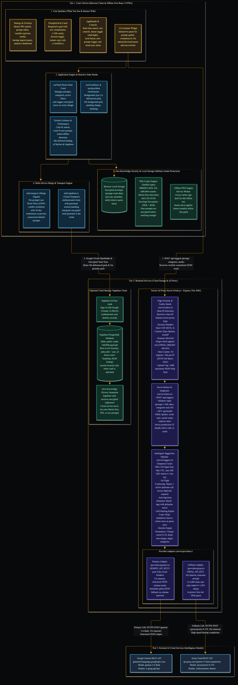

# PromptVault

> **Your personal, private library for AI prompts - organised, rated, and always at hand.**

<!-- Badges Section -->

  
  &nbsp;
  
  &nbsp;
  
  &nbsp;
  
  &nbsp;
  
  &nbsp;
  
  &nbsp;
  
  &nbsp;
  
  &nbsp;
  

  
  &nbsp;
  
  &nbsp;
  
  &nbsp;
  
  &nbsp;
  
  &nbsp;
  
  &nbsp;
  
  &nbsp;
  
  &nbsp;
  

  <strong><a href="https://microsoftedge.microsoft.com/addons/detail/promptvault-ai-prompt-m/ckhifhpbhebgnfomgcojfakpampkijni">🧩 Install on Microsoft Edge</a></strong> &nbsp;•&nbsp;
  <strong><a href="https://promptvault.multihat.dev/">🚀 Launch Live Web App</a></strong> &nbsp;•&nbsp;
  <strong><a href="docs/README.md">📖 Architecture & Docs Portal</a></strong> &nbsp;•&nbsp;
  <strong><a href="diagrams/">🗺️ 300% DPI Architecture Diagrams</a></strong> &nbsp;•&nbsp;
  <strong><a href="#-encrypt-your-vault">🔒 Zero-Knowledge Security</a></strong>

---

## 📋 Table of Contents

- [Comprehensive Architectural & Feature Synthesis](#comprehensive-architectural--feature-synthesis)
  - [Architectural Breakdown](#architectural-breakdown)
  - [Visual Architecture & System Models (300% DPI)](#visual-architecture--system-models-300-dpi)
  - [Docs-as-Code Technical Documentation Portal](#docs-as-code-technical-documentation-portal)
- [What is PromptVault?](#what-is-promptvault)
- [What Can It Do? (Features)](#what-can-it-do)
  - [Browser Extension (Edge & Chromium)](#-browser-extension-microsoft-edge--chromium)
- [How Does It Compare?](#how-does-it-compare)
- [Security & Privacy](#is-my-data-safe)
  - [Privacy Policy & Zero Prompt Tracking](PRIVACY.md)
- [Contributing & Community](#contributing--community)
- [License & Attribution](#license--attribution)

---

## 🏛️ Comprehensive Architectural & Feature Synthesis 

PromptVault is a privacy-first, client-encrypted AI prompt workbench and local library built with an offline-first architecture, an integrated AI Librarian (powered by Google Gemini with multi-key pooling and Groq fallback), dynamic {{variable}} template injection, multi-device cloud synchronization via Supabase, and real-time usage analytics.

### Architectural Breakdown

<pre align="center">
┌─────────────────────────────────────────────────────────────────────────────────────────┐
│                                 PROMPTVAULT ECOSYSTEM                                   │
├──────────────────────────────────────┬──────────────────────────────────────────────────┤
│ 🎨 Frontend (Client-Side)            │ 🔒 Cryptography & Storage Layer                 │
│ • React 19 + TypeScript 5.8 (Strict) │ • AES-256-GCM on-device encryption               │
│ • Tailwind CSS v4 + Motion           │ • PBKDF2-SHA-256 KDF (600,000 iterations)        │
│ • Virtualized Grid (>200 items)      │ • 6-digit PIN entropy + Emergency Recovery Key   │
│ • Offline PWA + Pre-paint Theme Init │ • Active session memory zeroing on manual lock   │
│ • Active theme preservation on lock  │ • Guarded localStorage with quota-aware error    │
├──────────────────────────────────────┼──────────────────────────────────────────────────┤
│ 🧠 AI Librarian Proxy Server         │ ☁️ Cloud Sync & Data Resilience                 │
│ • Express + TypeScript proxy         │ • Supabase PostgreSQL backend with Google OAuth  │
│ • Dual-Provider: Gemini + Groq       │ • Per-Entity LWW merge with 30-day tombstones    │
│ • Multi-Key Pool with 429 Cooldown   │ • Conflict-free cross-device synchronization     │
│ • SHA-256 LRU Cache & Coalescing     │ • JSON Import/Export with Schema Sanitization    │
└──────────────────────────────────────┴──────────────────────────────────────────────────┘
</pre>

### Visual Architecture & System Models (300% DPI)

PromptVault includes a comprehensive visual library of super-ultra-high-quality architectural models rendered at 300% DPI (3x scale factor) in the [`diagrams/`](diagrams/) directory:

| Diagram Model | Focus Area | Resolution |
| :--- | :--- | :--- |
| **[System Architecture](diagrams/architecture.png)** | End-to-end 4-tier topology spanning Client, AI Gateway, LLM Providers, and Cloud Sync | 2352 x 6744 px |
| **[Cryptographic Workflow](diagrams/encryption-workflow.png)** | PBKDF2 derivation, 256-bit DEK generation, AES-256-GCM sealing, and 6-digit PIN / Passphrase unlocking | 2352 x 10482 px |
| **[Cloud Sync Lifecycle](diagrams/cloud-sync-lifecycle.png)** | 1-second debounced push, 30-second silent poll, LWW merge engine, and 30-day tombstone cleanup | 2352 x 17904 px |
| **[AI Suggestion Pipeline](diagrams/ai-suggestion-pipeline.png)** | Gemini multi-key pooling, Groq automatic circuit-breaker fallback, in-flight coalescing, and caching | 2352 x 25248 px |
| **[Runtime Workflows](diagrams/runtime-workflows.png)** | Smart template substitution, AI Prompt Doctor evaluation and rewriting, and portable JSON backup | 2256 x 17973 px |

 

<em>Figure 1: High-level System Architecture topology. Click the image to view the full 300% DPI high-resolution diagram.</em>

### Docs-as-Code Technical Documentation Portal

PromptVault features a complete, enterprise-grade technical documentation suite authored under the **Docs-as-Code** standard in [`docs/`](docs/):

| Directory | Document Title | Description | Primary Audience |
| :--- | :--- | :--- | :--- |
| [docs/00-overview/](docs/00-overview/vision-charter.md) | **[Vision & Charter](docs/00-overview/vision-charter.md)** | Core privacy problem statement, user personas, success KPIs, and strategic boundaries | Founders, Evaluators, All Users |
| [docs/01-product/](docs/01-product/prd.md) | **[Product Requirements (PRD)](docs/01-product/prd.md)** | Detailed user personas, MoSCoW feature prioritization table, and non-goals | Product Managers, Developers |
| [docs/02-requirements/](docs/02-requirements/srs.md) | **[Software Requirements (SRS)](docs/02-requirements/srs.md)** | Quantifiable engineering metrics, PBKDF2 rounds, latency budgets, and rate limits | Software Engineers, QA Leads |
| [docs/03-architecture/](docs/03-architecture/architecture.md) | **[Architecture Blueprint](docs/03-architecture/architecture.md)** | C4 Context, Container, Component, and Code models with 4-tier stack specification | Architects, Lead Developers |
| [docs/03-architecture/data-model.md](docs/03-architecture/data-model.md) | **[Data Model & Schema Spec](docs/03-architecture/data-model.md)** | Full Entity-Relationship Diagram (ERD), TypeScript schemas, and tombstone lifecycle | Database Designers, Developers |
| [docs/03-architecture/adr/](docs/03-architecture/adr/) | **[Architectural Decision Records (ADRs)](docs/03-architecture/adr/)** | Formal ADRs 0001 - 0004 covering Encryption, Dual AI Fallback, LWW Sync, and Proxy Isolation | Senior Engineers, System Architects |
| [docs/04-security/](docs/04-security/threat-model.md) | **[Threat Model & Security Spec](docs/04-security/threat-model.md)** | Plain-English security summary, STRIDE threat mitigations, and 5 mandatory invariants | Security Auditors, Compliance |
| [docs/05-api/](docs/05-api/api-spec.md) | **[API Specification & OpenAPI 3.1](docs/05-api/api-spec.md)** | Human-friendly API guide and machine-readable [OpenAPI 3.1.0 schema](docs/05-api/openapi.yaml) | API Developers, Integrators |
| [docs/06-testing/](docs/06-testing/test-strategy.md) | **[Test Strategy & Quality Plan](docs/06-testing/test-strategy.md)** | Quality framework covering 141 unit tests across 18 suites and Playwright E2E browser tests | QA Engineers, Contributors |
| [docs/07-operations/](docs/07-operations/deployment-guide.md) | **[Production Deployment Runbook](docs/07-operations/deployment-guide.md)** | Complete operations guide for VPS/Node.js, Docker containers, Railway, and Render | DevOps, Sysadmins, Self-Hosters |

---

## What is PromptVault?

If you use AI tools like ChatGPT, Gemini, or Claude, you've probably written some really good instructions (called **"prompts"**) that get great results - and then lost them. They end up buried in chat history, scattered across notes apps, or simply forgotten.

**PromptVault is a personal library for those prompts.** Think of it like a recipe book, but instead of cooking instructions, it stores your best AI instructions. You can:

- Save prompts with a title, category, and tags so you can find them again
- Rate and improve them using a built-in AI assistant
- Copy any prompt to your clipboard in one click, ready to paste into any AI tool
- Access everything privately, from any device, without handing your data to a third party

Everything is stored directly in your browser. No sign-up required. No ads. No data sharing. You own your vault.

---

## What Can It Do?

### 🔒 Encrypt Your Vault
You can encrypt the local vault with either a numeric PIN (minimum 6 digits for new vaults, 4 digits for legacy unlocks) or a passphrase (minimum 15 characters, recommended by default). PromptVault uses AES-256-GCM for vault data, PBKDF2-SHA-256 (600,000 iterations) to derive the key that unlocks it, and progressive cooldown delays after consecutive failed unlock attempts. Your secret is never stored. A PIN is convenient for local devices, but a long passphrase provides the highest cryptographic resistance against offline guessing. Save the one-time recovery key shown during setup.

- **Active Session Memory Hygiene**: When you manually lock your vault, decrypted prompt data in React state and internal memory references is immediately cleared and zeroed out. Open edit dialogs and modal overlays are automatically closed to prevent UI data leakage.
- **Defensive Storage Guard**: Storage write handlers guard against accidental unencrypted data persistence while the vault is locked.
- **Theme Setting Preservation**: Your active dark or light theme preference is preserved across locking, unlocking, and recovery cycles.

### 🤖 Built-In AI Assistant
Not sure if your prompt is well-written? The **AI Librarian** can:
- **Score it** out of 10 and explain what's weak
- **Rewrite it** into a better, more effective version
- **Suggest a title, category, and tags** so you don't have to think about filing

The AI assistant works privately through a backend service - your API keys are never exposed to the browser.

### 📂 Organise by Category
Create your own folders (called categories) - things like *Coding*, *Marketing*, *Writing*, or whatever fits your workflow. Rename or delete them any time. Each category shows a count of how many prompts it contains.

### ⭐ Favourites & Search
Star your most-used prompts so they're always one click away. A full-text search bar lets you find any prompt by its title, content, or tags - instantly, with no loading.

### 📊 Usage Statistics
A built-in dashboard shows you which prompts you use most, how active your library is, and your top categories - so you can see what's actually working in your workflow.

### 🔄 Fill-in-the-Blank Templates
Write a prompt once with placeholders like `{{topic}}` or `{{audience}}`. When you copy it, PromptVault will ask you to fill in each blank before putting it on your clipboard. Great for prompts you reuse with small variations every time.

### 💾 Backup & Restore
Export your entire vault as a single file at any time. If you ever switch devices or browsers, just import the file and everything is back instantly.

### ☁️ Optional Cloud Sync
If you want your prompts available on multiple devices (your laptop and phone, for example), you can sign in with Google. Your vault will stay in sync automatically. This is entirely optional - the app works perfectly without it.

### 🌗 Light & Dark Mode
Switch between a dark theme (easy on the eyes at night) and a light theme (great in sunlight). Your preference is remembered.

### 📱 Works on Mobile Too
The app is fully usable on phones and tablets. The sidebar slides in and out, buttons are large enough to tap, and the layout adjusts to any screen size.

### 🧩 Browser Extension (Microsoft Edge & Chromium)

PromptVault is officially available on the **Microsoft Edge Add-ons Store** and as a cross-browser Manifest V3 package for Chrome, Brave, and Opera. It brings your encrypted prompt vault directly into your daily AI workflows:

  

  
   
  <em>Figure: Official PromptVault listing on the Microsoft Edge Add-ons Store (Version 2.3.1). Click the screenshot to open the live store page.</em>

- **Official 1-Click Store Installation**: Install directly from the [Microsoft Edge Add-ons Store](https://microsoftedge.microsoft.com/addons/detail/promptvault-ai-prompt-m/ckhifhpbhebgnfomgcojfakpampkijni) with automatic background updates (Store ID: `0RDCK9QZNVBV`, Extension ID: `ckhifhpbhebgnfomgcojfakpampkijni`).
- **In-Chat Quick Picker Overlay (`Alt+P`)**: Press `Alt+P` (or `Option+P` on Mac) inside ChatGPT, Claude, Google Gemini, DeepSeek, Perplexity, or any webpage to search and inject prompts into the active chat box in one click. Isolated inside a shadow DOM to ensure host CSS isolation.
- **In-Chat Command Trigger (`/pv`)**: Type `/pv ` directly inside any AI chat input to open an instant prompt suggestion picker without moving your hands from the keyboard.
- **1-Click Web Clipping**: Select any text on any webpage, right-click, and choose **Save selection to PromptVault** to store prompt snippets directly into your vault.
- **Offline-First AES-256-GCM Security**: All prompts stay encrypted on your local machine using hardware-backed Web Crypto APIs.
- **Optional Multi-Device Cloud Sync**: Sign in with Google via `chrome.identity` to sync your encrypted prompt library across multiple computers with Supabase.
- **Chrome & Brave Sideloading**: Pre-built packages (`promptvault-extension-v2.3.1.zip`) are available under [Releases](https://github.com/SagarBiswas-MultiHAT/promptVault/releases/latest) for side-loading in Developer Mode via `Load unpacked`.

---

## How Does It Compare?

Why choose PromptVault instead of saving prompts in a general note-taking app or on a cloud prompt directory? Here is how it compares across key developer and privacy needs:

| Capability | PromptVault | Notion / Docs | Obsidian | Web Prompt Directories |
| :--- | :--- | :--- | :--- | :--- |
| **100% Offline-First** | Yes (zero network requirement) | No (cloud-dependent) | Yes (local markdown) | No (cloud-dependent) |
| **Direct Browser Integration** | Yes (Live Edge Add-on + Alt+P Overlay) | Web clipper only | Third-party plugin | None / Copy-paste |
| **Client-Side AES-256-GCM Encryption** | Yes (PBKDF2 + recovery key) | No | Community plugins only | No (stored on third-party servers) |
| **Built-in AI Prompt Refinement** | Yes (Gemini + Groq fallback) | Paid add-on required | Third-party plugin required | Limited or static only |
| **Variable Template Injection (`{{var}}`)** | Yes (interactive form before copy) | No native support | Templater plugin required | Rare |
| **Private API Key Proxy** | Yes (keys never reach the browser) | Not applicable | Direct client calls | Centralized / Hosted |
| **No Mandatory Account or Tracking** | Yes (anonymous page views only; zero prompt tracking) | Account required | Account not required | Account usually required |
| **Cross-Device Sync** | Optional (free Supabase backend) | Built-in | Paid or manual Git setup | Built-in (vendor locked) |
| **Open Source License** | Apache 2.0 | Proprietary | Proprietary | Mostly proprietary |

---

## Is My Data Safe?

Yes. Here's how PromptVault protects you:

| What | How |
|---|---|
| **Your AI keys are private** | They're stored on the server, never sent to your browser |
| **Encrypted local vault** | When enabled, prompt data is AES-256-GCM encrypted in browser storage; the secret is never stored |
| **Active session memory hygiene** | Decrypted prompts in React state and internal data references are synchronously zeroed upon manual lock, and all open dialogs are reset |
| **Brute-force PIN protection** | Minimum 6-digit numeric PIN requirement with progressive exponential backoff cooldown delays after consecutive failed attempts |
| **Defensive storage guard** | Storage write handlers block unencrypted writes while the vault is locked |
| **Your prompts stay local** | Everything lives in your browser unless you choose cloud sync. Sync payloads are plaintext JSON protected by Supabase RLS and TLS so a newly signed-in device can use the vault |
| **Anonymous page-view analytics** | General page view counts only; zero prompt text, search queries, or user inputs are ever tracked ([Privacy Policy](PRIVACY.md)) |
| **Zero-vulnerability toolchain** | 0 open vulnerabilities across dependencies via `npm audit` on Vite 6.4.5 |
| **The app can't be embedded** | Security headers prevent the app from being loaded inside other websites |
| **Abuse prevention** | The AI assistant is limited to 30 requests per minute per user |
| **Connections are restricted** | In production, only your own domain can talk to the server |

---

## Contributing & Community

PromptVault is an open-source project built for the AI community, and we welcome contributors of all skill levels.

- **Getting Started:** Read our [Contributing Guide](.github/CONTRIBUTING.md) for local setup, development commands, and pull request guidelines.
- **Documentation Portal:** Explore the full [Architecture & Engineering Documentation](docs/README.md) for C4 models, ERDs, and ADRs.
- **Security Inquiries:** Review our [Security Policy](.github/SECURITY.md) for responsible vulnerability disclosure and threat model details.
- **Join the Discussion:** Visit our [GitHub Discussions](https://github.com/SagarBiswas-MultiHAT/promptVault/discussions) to share your favorite prompt workflows, propose ideas, or ask questions.
- **Good First Issues:** Explore issues labeled `good first issue` on GitHub for well-scoped starter contributions.
- **Version History:** See [CHANGELOG.md](CHANGELOG.md) for a complete record of releases and changes.

---

## ⭐ Star History & Community Support

If you find PromptVault useful for your AI workflow or project, please consider giving this repository a star on GitHub! It helps more developers discover the project and keeps development active.

---

## License & Attribution

**PromptVault** is licensed under the [Apache License, Version 2.0](./LICENSE).

In accordance with **Section 4(d)** of the Apache License 2.0, any fork, redistribution, or hosted deployment of this application must retain the root [`NOTICE`](./NOTICE) file and maintain visible attribution to **Sagar Biswas ([@SagarBiswas-MultiHAT](https://github.com/SagarBiswas-MultiHAT))** within both the documentation and the user interface.

Cloning this repository, stripping `.git` commit history, removing copyright or `NOTICE` files, or misrepresenting this codebase as your own original work is a direct violation of the license and international copyright law, and will result in an immediate GitHub DMCA Takedown notice.
