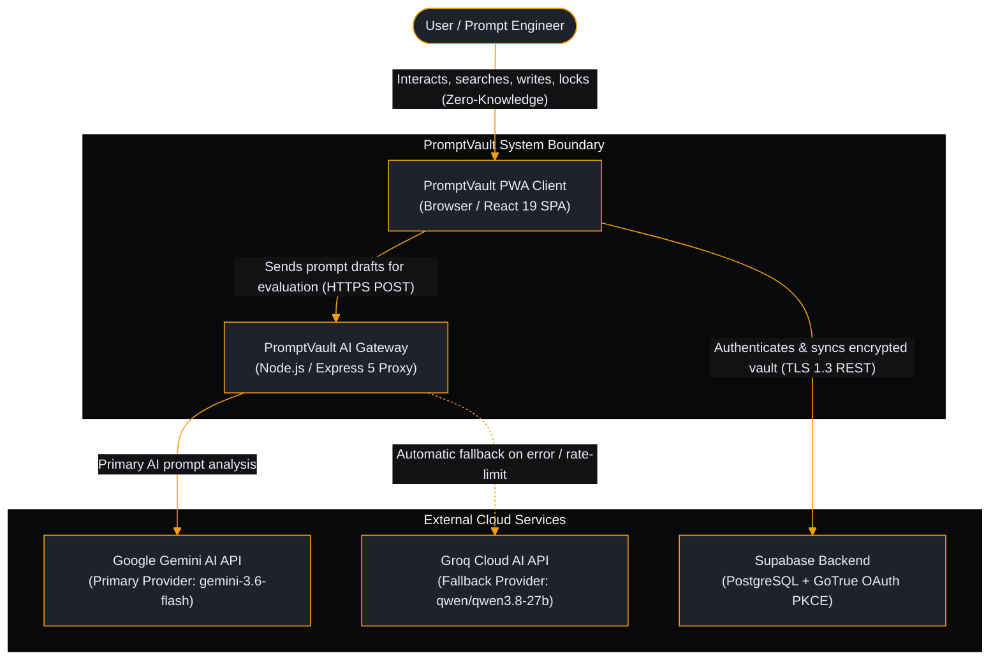
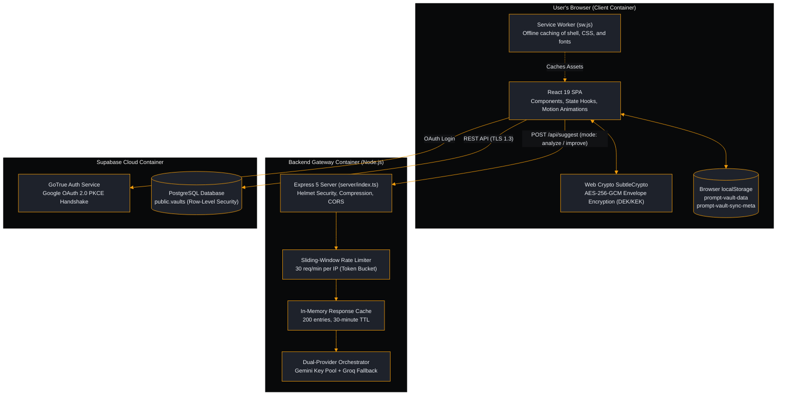

# System Architecture Document: PromptVault

| Metadata | Details |
| :--- | :--- |
| **Product Name** | PromptVault |
| **Document Type** | System Architecture & C4 Engineering Blueprint |
| **Status** | Approved (Production Baseline) |
| **Version** | v2.2.1 |
| **Owner / Lead Architect** | Sagar Biswas (@SagarBiswas-MultiHAT) / MultiHAT (<https://multihat.dev>) |
| **Reference Documents** | [Vision & Charter](file:///o:/github/promptVault/docs/00-overview/vision-charter.md), [PRD](file:///o:/github/promptVault/docs/01-product/prd.md), [SRS](file:///o:/github/promptVault/docs/02-requirements/srs.md) |

---

## 1. Executive Architecture Summary (The Simple Analogy)

To understand how PromptVault works behind the scenes, imagine a **secure, private research office**:

1. **The Front Desk (The React 19 UI)**: Where you sit and work. You can quickly search your filing cabinets, create new prompt index cards, favorite items, and personalize template blanks (`{{variables}}`). It responds instantly to keyboard commands.
2. **The Hidden Vault Safe (WebCrypto On-Device Encryption)**: Inside your office is a military-grade safe. When you close the office door (lock your vault), your notes are sealed inside an encrypted envelope using **AES-256-GCM and 600,000 calculation rounds**. Even if someone breaks into your computer and inspects your browser storage, they see only indecipherable scrambled text.
3. **The Confidential Courier (The Express AI Proxy)**: When you ask for AI advice to improve a prompt, a secure private courier takes your draft to consult two world-class prompt doctors (Google Gemini and Groq Cloud). The courier keeps your master API keys safely locked away so they never leak into the browser.
4. **The Encrypted Satellite Relay (Supabase Cloud Sync)**: When you want your prompts on your phone or laptop, your device syncs with your private cloud locker. If you made changes on two devices simultaneously, an intelligent merge engine automatically blends them using **Last-Write-Wins and 30-day deletion tombstones**, ensuring you never lose an edit or bring deleted prompts back from the dead.

---

## 2. C4 Architectural Blueprint

The C4 model visualizes the architecture at four progressively deeper levels of abstraction:

### Level 1: System Context Diagram (The Big Picture)

### Level 2: Container Diagram (Runtime Applications & Datastores)

### Level 3: Component Diagram (Client Architecture Breakdown)

The client application is organized into four clean architectural layers:

1. **Presentation Layer (Components)**:
   - `App.tsx`: Central coordinator managing views and global shortcuts.
   - `PromptGrid.tsx` & `PromptCard.tsx`: Virtualized card grid with dynamic favorite and copy badges.
   - `AiAssistantWidget.tsx`: Floating assistant dialog supporting Analyze and Improve workflows.
   - `VariableForm.tsx`: Modal for interactive template variable extraction and substitution.
   - `PinLock.tsx`: Modal dialog for PIN/Passphrase unlock and emergency key recovery.
   - `SettingsModal.tsx` & `StatsDashboard.tsx`: Controls for cloud sync, exports, and analytics.
2. **Engine Layer (Reactive Hooks)**:
   - `useVault.ts`: Core state store managing prompts, categories, sorting, and versioned encrypted saves.
   - `useCloudSync.ts`: Cloud synchronization controller running the 1-second push debounce and 30-second poll interval.
   - `useSyncMeta.ts`: Local storage tracker for sync timestamps, pending flags, and echo suppression.
   - `useLazyModule.ts`: Idle-time deferred loader for non-critical vendor modules (`motion`, `@supabase/supabase-js`).
3. **Cryptographic & Utility Layer**:
   - `crypto.ts`: WebCrypto engine managing PBKDF2 (600,000 rounds), DEK generation, and AES-256-GCM wrappers.
   - `merge.ts`: Last-Write-Wins conflict resolution engine and 30-day tombstone cleanup.
   - `vault.ts`: Data normalizers, search index builders, and schema validators (`describeVaultProblems`).
4. **Transport Layer**:
   - `supabase.ts`: Authenticated client client-side singleton managing user JWT sessions.

### Level 4: Code & Security Boundaries (Memory vs Storage vs Wire)

| Boundary Zone | Security Level | Data Format | Protection Mechanism |
| :--- | :--- | :--- | :--- |
| **Zone 1: Active RAM** | Transient Memory | Plaintext prompts & active `CryptoKey` in memory ref | Scoped to active browser tab only; zeroed out immediately upon vault lock. |
| **Zone 2: On-Device Storage** | Encrypted at Rest | Encrypted Envelope JSON (`schemaVersion: 2.0.0`) | AES-256-GCM ciphertext; zero plaintext prompts and zero PIN hashes on disk. |
| **Zone 3: Transport Wire** | Encrypted in Transit | TLS 1.3 Encrypted REST & OAuth PKCE | HTTPS with strict Content Security Policy and HSTS preloading. |
| **Zone 4: Cloud Database** | Isolated by Identity | JSONB Vault Payload in `public.vaults` | PostgreSQL Row-Level Security ensuring `auth.uid() = user_id`. |

---

## 3. Technology Stack Selection & Technical Rationale

Every component in PromptVault's technology stack was chosen based on concrete engineering criteria:

| Technology | Selection Decision | Why It Was Chosen Over Alternatives |
| :--- | :--- | :--- |
| **React 19** | Frontend Framework | State-of-the-art concurrent rendering, native support for action hooks, and seamless component lifecycle control without heavy external state libraries. |
| **TypeScript 5.8 (Strict)** | Programming Language | 100% strict type safety eliminates undefined runtime errors, guarantees cryptographic schema contracts, and enables safe refactoring across components. |
| **Vite 6** | Build & Dev Tooling | Sub-second Hot Module Replacement (HMR), optimized production tree-shaking, and native ES module bundling for minimal bundle overhead. |
| **Tailwind CSS v4** | UI Styling Engine | Native CSS variable engine, zero runtime overhead, instant dark/light mode toggling, and micro-animation support without CSS bloat. |
| **Web Crypto API (SubtleCrypto)** | Cryptographic Core | Native W3C browser standard running in C++ browser core; leverages hardware-accelerated AES-NI CPU instructions; generates non-extractable keys immune to memory inspection. |
| **Node.js 20+ & Express 5** | AI Proxy Gateway | Lightweight, high-throughput asynchronous I/O; clean middleware pipeline for Helmet security headers, gzip compression, and token-bucket IP rate limiting. |
| **Supabase (Postgres + GoTrue)** | Cloud Sync Tier | Eliminates the security risk of managing a custom user database; PostgreSQL Row-Level Security provides mathematical data isolation between users. |

---

## 4. Deep-Dive Cross-Reference to the 5 Core Architectural Diagrams

PromptVault's architecture is comprehensively documented across five verified, production-aligned diagrams:

1. [Architecture Overview Diagram](file:///o:/github/promptVault/diagrams/architecture.png): Complete visual representation of the 4-layer runtime stack, client hooks, security engine, and cloud transport.
2. [Zero-Knowledge Encryption Workflow](file:///o:/github/promptVault/diagrams/encryption-workflow.png): Step-by-step breakdown of Master Key (DEK) generation, Primary KEK derivation, Emergency Recovery KEK derivation, and everyday unlock sequences.
3. [Cloud Sync Lifecycle](file:///o:/github/promptVault/diagrams/cloud-sync-lifecycle.png): Chronological lifecycle covering Session Bootstrap, 1-Second Debounced Push, 30-Second Silent Polling, and Last-Write-Wins tombstone reconciliation.
4. [AI Suggestion Pipeline](file:///o:/github/promptVault/diagrams/ai-suggestion-pipeline.png): Detailed engineering walkthrough of the sliding-window rate limiter, 30-minute cache, Gemini-to-Groq fallback, and 8-point rubric evaluation.
5. [Runtime Workflows](file:///o:/github/promptVault/diagrams/runtime-workflows.png): End-to-end user journeys for smart template copy, AI Prompt Doctor polishing, and schema-sanitized JSON import/export.
