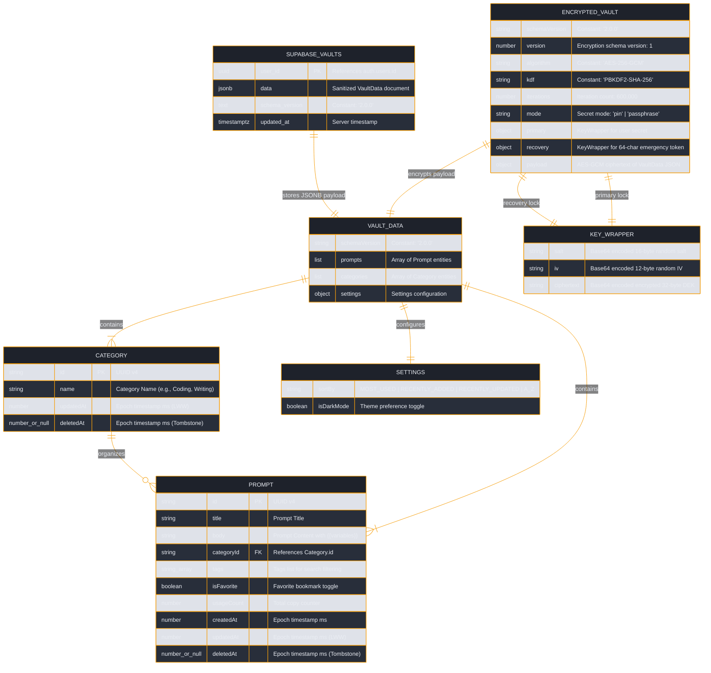
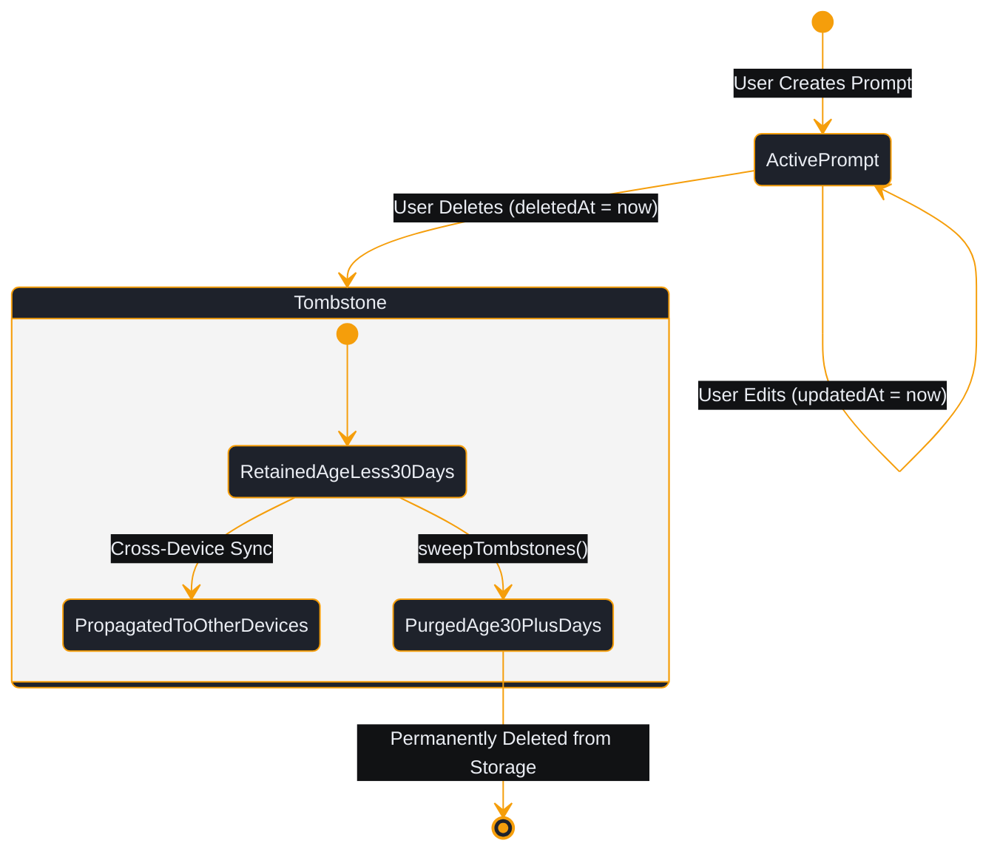

# Data Model & Schema Specification: PromptVault

| Metadata | Details |
| :--- | :--- |
| **Product Name** | PromptVault |
| **Document Type** | Data Model, ERD & Schema Specification |
| **Status** | Approved (Production Baseline) |
| **Version** | v2.2.1 (Schema Version `2.0.0`) |
| **Owner / Lead Architect** | Sagar Biswas (@SagarBiswas-MultiHAT) / MultiHAT (<https://multihat.dev>) |
| **Reference Documents** | [Architecture Blueprint](file:///o:/github/promptVault/docs/03-architecture/architecture.md), [SRS](file:///o:/github/promptVault/docs/02-requirements/srs.md) |

---

## 1. Executive Summary (How Data is Structured)

PromptVault is designed around a **clean, modular, and privacy-preserving data model**. Unlike traditional web applications that fragment user records across dozens of relational database tables on a remote server, PromptVault models your prompt library as a **self-contained document vault**:

- **Locally on your device**: Your library lives as a single, coherent JSON document (`VaultData`) in memory. When locked, it is packaged into an impenetrable cryptographic envelope (`EncryptedVault`) stored in your browser's local storage.
- **In the cloud (optional)**: Your library syncs as a single record per user in a dedicated PostgreSQL table (`public.vaults`), protected by Row-Level Security so only your authenticated Google account can read or write it.
- **Every entity is self-healing**: Prompts and categories carry exact creation, modification, and deletion timestamps (`createdAt`, `updatedAt`, `deletedAt`), enabling seamless multi-device merging without data loss.

---

## 2. Entity Relationship Diagram (ERD)

The following diagram illustrates the relationships between entities in memory, at rest, and in the cloud:



---

## 3. Data Dictionary

### 3.1 Entity: `Prompt`
Represents an individual AI prompt entry within the user's library.

| Field | Type | Required | Description & Constraints |
| :--- | :--- | :--- | :--- |
| `id` | `string` | Yes | Universally unique identifier (UUID v4) generated via `crypto.randomUUID()`. |
| `title` | `string` | Yes | Human-readable title of the prompt (e.g., *"Senior Code Reviewer"*). |
| `body` | `string` | Yes | Full prompt text. May contain dynamic template variables matching `{{variable_name}}`. |
| `categoryId` | `string` | Yes | UUID reference to the parent `Category.id`. |
| `tags` | `string[]` | Yes | Array of lowercase tag strings (e.g., `["typescript", "testing"]`) used for filtering. |
| `isFavorite` | `boolean` | Yes | Flag indicating whether the prompt is starred. Defaults to `false`. |
| `usageCount` | `number` | Yes | Integer counter tracking total copy actions. Increments by 1 on each copy. |
| `createdAt` | `number` | Yes | Epoch timestamp in milliseconds when the prompt was originally created. |
| `updatedAt` | `number` | Yes | Epoch timestamp in milliseconds of the last modification. Used for Last-Write-Wins merge. |
| `deletedAt` | `number \| null` | Yes | Soft-deletion epoch timestamp in milliseconds, or `null` if active. Functions as a sync tombstone. |

---

### 3.2 Entity: `Category`
Represents an organizational folder grouping related prompts.

| Field | Type | Required | Description & Constraints |
| :--- | :--- | :--- | :--- |
| `id` | `string` | Yes | Universally unique identifier (UUID v4). |
| `name` | `string` | Yes | Display name of the category (e.g., *"Development"*, *"Writing"*, *"Productivity"*). |
| `updatedAt` | `number` | Yes | Epoch timestamp in milliseconds of the last rename or creation. |
| `deletedAt` | `number \| null` | Yes | Soft-deletion epoch timestamp, or `null` if active. Cascades deletion to child prompts. |

---

### 3.3 Entity: `Settings`
User interface preferences stored inside the vault payload.

| Field | Type | Required | Description & Allowed Values |
| :--- | :--- | :--- | :--- |
| `sortBy` | `SortOption` | Yes | Prompt sort order: `'RECENTLY_ADDED'`, `'RECENTLY_UPDATED'`, `'MOST_USED'`, or `'A_Z'`. |
| `isDarkMode` | `boolean` | Yes | Active theme mode. `true` for Dark Theme, `false` for Light Theme. Defaults to `true`. |

---

### 3.4 Entity: `EncryptedVault` (On-Device Storage Envelope)
The cryptographic container stored in `localStorage` under `prompt-vault-data`.

| Property Path | Type | Description |
| :--- | :--- | :--- |
| `schemaVersion` | `string` | Schema format identifier (`'2.0.0'`). |
| `encryption.version` | `number` | Version of the encryption envelope specification (`1`). |
| `encryption.algorithm` | `string` | Symmetric cipher: `'AES-256-GCM'`. |
| `encryption.kdf` | `string` | Key derivation function: `'PBKDF2-SHA-256'`. |
| `encryption.iterations`| `number` | Number of PBKDF2 hashing rounds (`600000`). |
| `encryption.mode` | `string` | User secret type: `'pin'` (numeric) or `'passphrase'` (alphanumeric). |
| `encryption.primary` | `KeyWrapper` | Wrapper containing salt, IV, and ciphertext of DEK encrypted with user's KEK. |
| `encryption.recovery`| `KeyWrapper` | Wrapper containing salt, IV, and ciphertext of DEK encrypted with emergency token KEK. |
| `encryption.payload` | `object` | Object containing `iv` (12-byte base64) and `ciphertext` (AES-GCM encrypted JSON string of `VaultData`). |

---

### 3.5 Entity: `SyncMeta` (Local Sync Bookkeeping)
Stored in browser `localStorage` under `prompt-vault-sync-meta` to manage cloud synchronization state.

| Field | Type | Description |
| :--- | :--- | :--- |
| `lastLocalChangeAt` | `number \| null` | Epoch timestamp in ms when the user last edited data on this specific device. |
| `lastRemoteChangeAt` | `number \| null` | Server timestamp in ms of the last cloud row observed from Supabase. |
| `lastSyncedAt` | `number \| null` | Epoch timestamp in ms of the last successful network push or pull. |
| `pendingSync` | `boolean` | Flag indicating whether unpushed local modifications exist on this device. |
| `suppressLocalChange` | `boolean` | Internal memory flag that prevents a received cloud pull from echoing back as a push. |

---

### 3.6 Database Table: `public.vaults` (Supabase Cloud Storage)
PostgreSQL table schema managed in [supabase/migrations/0001_vaults.sql](file:///o:/github/promptVault/supabase/migrations/0001_vaults.sql).

```sql
create table if not exists public.vaults (
  user_id uuid primary key references auth.users(id) on delete cascade,
  data jsonb not null,
  schema_version text not null,
  updated_at timestamptz not null default now()
);

alter table public.vaults enable row level security;
```

| Column | PostgreSQL Type | Constraints | Description |
| :--- | :--- | :--- | :--- |
| `user_id` | `UUID` | Primary Key, References `auth.users(id)` | Identity of the authenticated user from Google OAuth 2.0 PKCE. |
| `data` | `JSONB` | NOT NULL | Sanitized `VaultData` payload (stripped of all local secrets and encryption wrappers). |
| `schema_version` | `TEXT` | NOT NULL | Active schema version (`'2.0.0'`). |
| `updated_at` | `TIMESTAMPTZ`| NOT NULL, Default `now()` | Timestamp of last cloud save. Compared during 30s background poll. |

---

## 4. Schema Versioning & Sanitization Rules

### Schema Migration Detection
The application detects and handles legacy or unencrypted vaults through runtime schema validation:
- Current Standard: `SCHEMA_VERSION = '2.0.0'`.
- Legacy Upgrade: If a raw `VaultData` object in storage has `schemaVersion !== '2.0.0'` and lacks an `encryption` block, the UI surfaces a `needsEncryptionUpgrade` status prompting the user to upgrade to AES-256-GCM protection.

### Vault Normalization (`sanitizeVault`)
To guarantee that corrupted JSON imports or partial syncs never crash the UI, `sanitizeVault()` enforces defensive invariants:
1. Guaranteed Arrays: Ensures `prompts` and `categories` are always arrays, converting null or undefined to `[]`.
2. Field Defaults: Populates missing `tags` with `[]`, missing `isFavorite` with `false`, and missing `usageCount` with `0`.
3. Timestamp Fallbacks: Missing `createdAt` or `updatedAt` timestamps automatically default to `Date.now()`.
4. Schema Tagging: Forces `schemaVersion` to `'2.0.0'`.

---

## 5. Data Retention & Tombstone Lifecycle

PromptVault solves the classic distributed sync problem of resurrected deleted items using **30-Day Deletion Tombstones**:



1. **Deletion Marks a Tombstone**: When a user deletes a prompt or category, `deletedAt` is populated with `Date.now()`.
2. **Propagating the Deletion**: When another device syncs via `mergeVaults()`, it compares timestamps:
   - If Device B has an active prompt with an older `updatedAt`, the incoming tombstone from Device A wins, marking the item deleted on Device B.
   - If timestamps are identical, the tombstone wins as a tie-breaker.
3. **Automatic Garbage Collection (`sweepTombstones`)**:
   - Tombstones with `Date.now() - deletedAt < 30 days` are retained.
   - Tombstones older than 30 days (`30 * 86,400,000` ms) are permanently purged during merge passes to reclaim local storage capacity.
