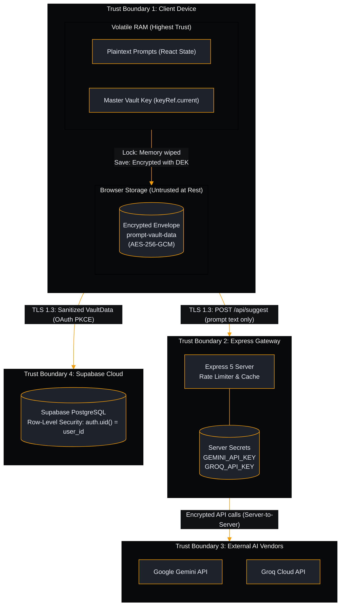

# Threat Model & Security Specification: PromptVault

| Metadata | Details |
| :--- | :--- |
| **Product Name** | PromptVault |
| **Document Type** | Threat Model & Security Risk Analysis (STRIDE) |
| **Status** | Approved (Production Baseline) |
| **Version** | v2.2.1 |
| **Owner / Lead Architect** | Sagar Biswas (@SagarBiswas-MultiHAT) / MultiHAT (<https://multihat.dev>) |
| **Reference Documents** | [Architecture Blueprint](file:///o:/github/promptVault/docs/03-architecture/architecture.md), [SRS](file:///o:/github/promptVault/docs/02-requirements/srs.md), [ADR 0001](file:///o:/github/promptVault/docs/03-architecture/adr/0001-envelope-encryption.md) |

---

## 1. Security in Plain English (Executive Summary)

When you write AI prompts, you often include confidential ideas, proprietary business strategies, software code snippets, and personal thoughts. Traditional web apps store these notes on their own corporate servers where employees, hackers, or automated scripts could potentially read them.

**PromptVault takes a zero-knowledge approach.** 

Think of PromptVault like a **high-security safe inside your own home**:
- **You hold the only keys**: PromptVault locks your prompts using the **AES-256-GCM cipher** and derives your secret key using **600,000 calculation rounds** (PBKDF2).
- **Your computer disk never sees plaintext**: Even if someone steals your laptop or inspects your browser storage files, they see only scrambled cryptographic noise.
- **Your PIN is never saved**: PromptVault never saves your PIN, passphrase, or password hash anywhere on your disk.
- **No central backdoor**: The creators of PromptVault cannot unlock your data, even if compelled, because your keys never leave your device.
- **Protected AI courier**: When you ask for AI prompt advice, your private third-party AI credentials remain locked on the server and are never exposed to the web browser.

---

## 2. System Assets & Data Classification

To protect PromptVault effectively, all system data is classified into three distinct security tiers:

| Sensitivity Tier | Asset Description | Storage Location | Protection Objective |
| :--- | :--- | :--- | :--- |
| **Tier 1: Secret / Critical** | - Master Vault Key (DEK, 32-byte AES key) - User unlocking secret (PIN / Passphrase) - Emergency Recovery Key (64-char hex token) - Server AI Keys (`GEMINI_API_KEY`, `GROQ_API_KEY`) | - Active RAM only (`keyRef.current`) - Never stored on disk - Offline paper / secret vault - Server environment variables | Absolute confidentiality. Zero storage at rest on client disk. Memory zeroing upon lock. |
| **Tier 2: Confidential** | - Prompt titles, bodies, and custom tags - Category names and organizational structure - Cloud backup JSONB payload | - Local storage (Encrypted envelope) - Supabase `public.vaults` (TLS + RLS) | Strict confidentiality and integrity. No plaintext on disk or in transit. |
| **Tier 3: Public / Unclassified** | - Application HTML, CSS, and JS bundles - Dark / Light theme preference (`isDarkMode`) - Active sort selection (`sortBy`) | - Browser cache & Service Worker - Local storage | Availability and integrity. |

---

## 3. Trust Boundaries & Attack Surfaces

The PromptVault architecture contains four critical trust boundaries:

---

## 4. STRIDE Threat Analysis & Mitigations

The STRIDE model analyzes six categories of security threats against PromptVault's architecture:

### 4.1 Spoofing (Identity Deception)
* **Threat S1: User Impersonation in Cloud Sync**: An attacker attempts to query or modify another user's private vault row in Supabase by sending a forged user ID.
  - *Severity*: Critical.
  - *Mitigation*: The `public.vaults` table strictly enforces PostgreSQL Row-Level Security (RLS). The policies (`SELECT`, `INSERT`, `UPDATE`, `DELETE`) evaluate `auth.uid() = user_id` against the cryptographically signed JWT issued by Supabase GoTrue Auth. Even with direct API access, an attacker can only read or write their own row.
* **Threat S2: API Gateway Abuse by Impersonating Client**: A malicious bot attempts to send automated scraping requests to `/api/suggest`.
  - *Severity*: Medium.
  - *Mitigation*: The Express server enforces CORS restrictions matching the app origin and applies an IP-based sliding-window rate limiter (30 requests per minute per IP).

### 4.2 Tampering (Data Modification)
* **Threat T1: Ciphertext Tampering in Local Storage**: An attacker or rogue browser extension attempts to alter the stored encrypted envelope JSON in `localStorage` to bypass protection or corrupt records.
  - *Severity*: High.
  - *Mitigation*: PromptVault uses **AES-256-GCM**, an Authenticated Encryption with Associated Data (AEAD) cipher. It computes a 128-bit authentication tag during encryption. If even a single bit of the ciphertext, salt, or IV is tampered with, `crypto.subtle.decrypt` throws an `OperationError`, immediately aborting decryption and leaving the vault locked.
* **Threat T2: Man-in-the-Middle (MITM) Asset Tampering**: An attacker on an untrusted Wi-Fi network attempts to inject malicious scripts into the application bundle during download.
  - *Severity*: Critical.
  - *Mitigation*: Enforced HTTPS with HTTP Strict Transport Security (HSTS) with a 1-year duration (`max-age=31536000; includeSubDomains; preload`). A rigid Content Security Policy (CSP) restricts scripts strictly to `'self'`.

### 4.3 Repudiation (Disavowing Actions)
* **Threat R1: Conflicting or Denied Multi-Device Edits**: A user makes edits on their phone and laptop simultaneously, then claims edits were mysteriously deleted or overwritten by the system.
  - *Severity*: Low.
  - *Mitigation*: PromptVault maintains strict, immutable epoch timestamps (`updatedAt` and `deletedAt`) per entity. The merge engine in [merge.ts](file:///o:/github/promptVault/src/utils/merge.ts) deterministically reconciles records using Last-Write-Wins and retains deletion tombstones for 30 days, creating a verifiable deterministic audit trail of which device held the latest edit.

### 4.4 Information Disclosure (Data Leaks)
* **Threat I1: Physical Theft of Device (Offline Brute-Force)**: A thief steals the user's laptop or exports their browser storage folder, attempting to crack the PIN to read confidential prompts.
  - *Severity*: Critical.
  - *Mitigation*: 
    1. Zero plaintext prompts exist on disk.
    2. PromptVault uses **PBKDF2-SHA-256 with 600,000 calculation rounds**. For new vaults, PromptVault enforces a minimum of 6 numeric digits (1,000,000 keyspace) and defaults to Passphrase (>= 15 characters, recommended). Furthermore, the client interface imposes progressive delay cooldowns after consecutive failed attempts to thwart rapid local brute-forcing, while legacy 4-digit vaults retain unlock compatibility.
* **Threat I2: Third-Party AI API Key Leakage**: An attacker inspects client-side source maps or network traffic to extract Google Gemini or Groq API keys.
  - *Severity*: High.
  - *Mitigation*: Third-party API keys reside strictly on the server in `process.env`. The client communicates solely with `/api/suggest`. The Vite bundler strictly excludes server environment variables from the client production bundle.
* **Threat I3: AI Vendor Data Retention / Public Training**: A user fears their prompts will be used by Google or Groq to train future public AI models.
  - *Severity*: Medium.
  - *Mitigation*: Commercial enterprise API endpoints for Google Gemini and Groq Cloud operate under strict commercial terms of service that do not train public foundation models on API payload data. Furthermore, prompt evaluation is strictly on-demand: prompts are only sent over the network when the user explicitly clicks "Analyze" or "Improve".
* **Threat I4: Browser Memory Dumping**: An attacker inspects active RAM while the application is locked.
  - *Severity*: Medium.
  - *Mitigation*: Clicking "Lock Vault" synchronously sets `keyRef.current = null`, wiping the active `CryptoKey` from memory and replacing React state with an empty vault before displaying the PIN lock screen.

### 4.5 Denial of Service (DoS)
* **Threat D1: AI API Quota Exhaustion**: An attacker floods `/api/suggest` with massive prompt texts or rapid-fire requests to drive up API costs and cause service outages for legitimate users.
  - *Severity*: High.
  - *Mitigation*:
    1. **Rate Limiting**: Enforced at 30 requests per minute per IP via an in-memory sliding-window limiter.
    2. **Input Payload Cap**: Requests exceeding 10,000 characters are rejected before calling external LLMs.
    3. **In-Memory Caching**: Identical prompts return pre-computed evaluations from an in-memory cache (30-minute TTL, 200 entries) in <= 15 milliseconds without incurring third-party API costs.
* **Threat D2: Browser Local Storage Quota Exhaustion**: A user imports an excessively large JSON file or creates thousands of prompts, exceeding the browser's 5MB storage limit and crashing the app.
  - *Severity*: Medium.
  - *Mitigation*: Storage operations are wrapped in quota monitoring. If `writeJson()` catches a `QuotaExceededError`, it records an error state and renders a `StorageErrorBanner`, allowing the user to export their library or delete old prompts cleanly.

### 4.6 Elevation of Privilege (Unauthorized Access)
* **Threat E1: Bypassing PIN Lock via Browser Console**: An attacker opens Developer Tools on a locked tab and attempts to flip `isLocked = false` in React state.
  - *Severity*: High.
  - *Mitigation*: Flipping the UI state is futile. Without the Master Vault Key (DEK), the application holds only encrypted ciphertext. The DEK can only be unwrapped by submitting the correct PIN or recovery key to the Web Crypto SubtleCrypto engine, which verifies the cryptographic GCM auth tag before releasing the key.
* **Threat E2: Cross-Site Scripting (XSS)**: An attacker injects malicious script tags into a prompt body (e.g. ``) to hijack memory.
  - *Severity*: Critical.
  - *Mitigation*:
    1. React automatically escapes all string expressions rendered in JSX, preventing raw HTML execution.
    2. PromptVault strictly avoids `dangerouslySetInnerHTML`.
    3. The server's Content Security Policy (`default-src 'self'`) prohibits inline script execution and unauthorized remote script domains.

---

## 5. Security Invariants (Rules That Must Never Be Broken)

1. **The Zero-Plaintext Invariant**: Plaintext prompt titles, prompt bodies, tags, or PIN hashes must never be written to `localStorage` when encryption is enabled.
2. **The Memory Zeroing Invariant**: The Master Vault Key (`keyRef.current`) and all decrypted prompt arrays in React state and `dataRef` must be zeroed synchronously whenever the vault is locked.
3. **The Key Isolation Invariant**: Upstream AI API keys (`GEMINI_API_KEY`, `GROQ_API_KEY`) must never appear in client bundles, network requests sent to the browser, or client-side storage.
4. **The Authenticated Encryption Invariant**: All vault payload encryptions must use AES-256-GCM with a fresh 12-byte initialization vector (`crypto.getRandomValues`) per write.
5. **The Identity Isolation Invariant**: All Supabase database mutations must be guarded by PostgreSQL Row-Level Security verifying `auth.uid() = user_id`.

---

## 6. Residual Risks & User Responsibilities

While PromptVault provides military-grade cryptographic protection, security is a shared responsibility. Users must observe the following precautions:

- **Endpoint Device Security**: If the user's host machine is infected with kernel-level keyloggers or screen-scraping malware while the vault is actively unlocked, data in active memory could be compromised. Users must maintain up-to-date operating systems and antivirus hygiene.
- **Safekeeping the Emergency Recovery Key**: PromptVault has no central password reset server. If a user forgets their PIN and loses their 64-character Emergency Recovery Key, **their data cannot be recovered by anyone**. The recovery key should be printed or stored in an offline password manager.
- **Browser Extension Hygiene**: Users should avoid installing untrusted browser extensions that request broad read/write permissions across all web pages.
- **Dependency & Tooling Hygiene**: Development tooling dependencies are audited via `npm audit` (0 reported vulnerabilities) and pinned against vulnerable local dev-server middleware.
